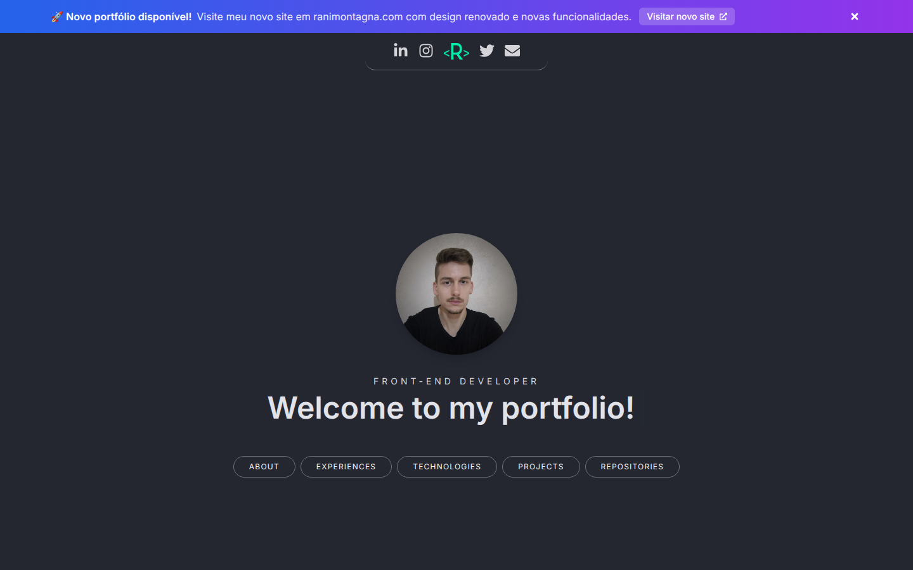
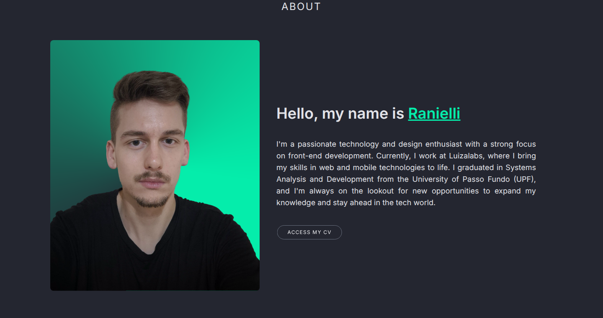
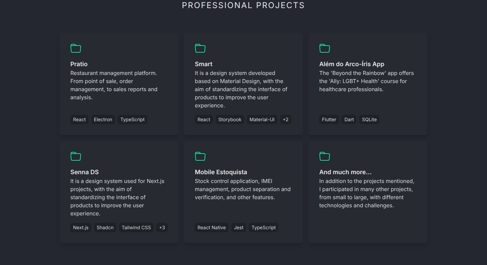
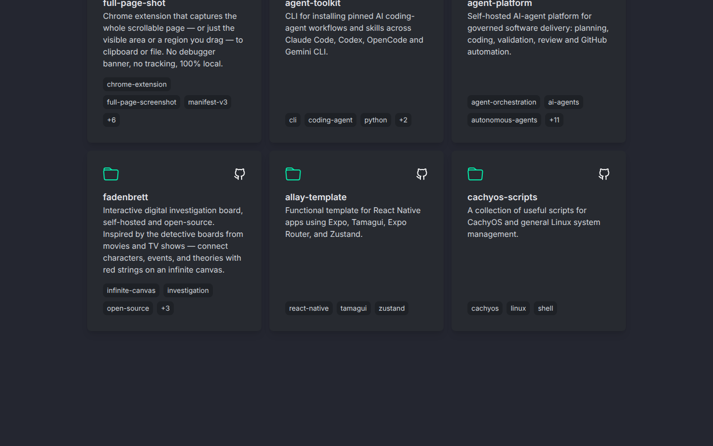
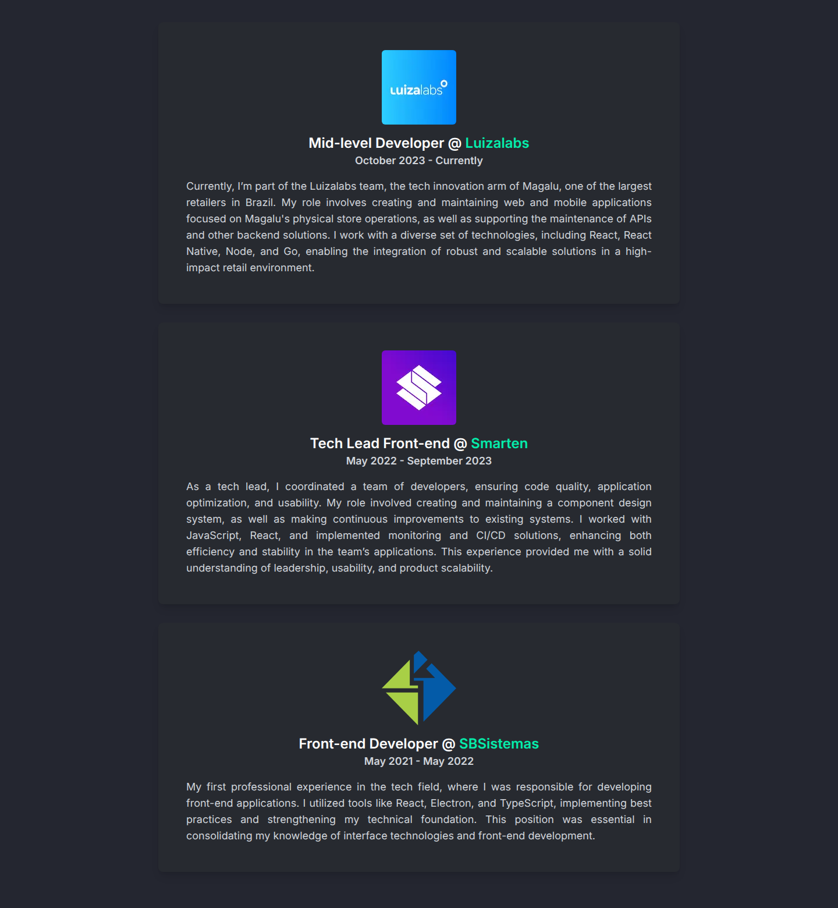
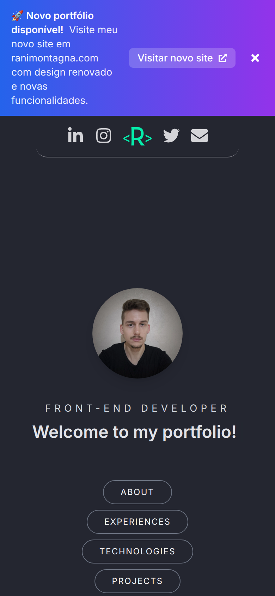

<div align="center">

# nextlp

**My personal portfolio from 2022 to 2025: a one-page site in Portuguese and English with my experience, projects and public GitHub repositories. It was ranimontagna.com until my current site replaced it.**


[**Live site**](https://old.ranimontagna.com/) •
[Features](#features) •
[Screenshots](#screenshots) •
[Project layout](#project-layout) •
[Running locally](#running-locally) •
[History](#project-history)

</div>

> [!WARNING]
> **Discontinued.** nextlp is no longer maintained and this repository is archived as a portfolio reference. My current site is [ranimontagna.com](https://ranimontagna.com). This one is still online at [old.ranimontagna.com](https://old.ranimontagna.com/), with a banner pointing to the new site, and its content stops in late 2024.



## About

I started nextlp in September 2022 to replace my previous site, [rani-website](https://github.com/RanielliMontagna/rani-website), and kept it as my portfolio for three years. The first version ran on the Next.js 13 pages router with next-i18next and Jest. In November 2024 I rewrote it on the App Router with next-intl and Vitest, added lint and test workflows and brought coverage to 100%. When my new site launched in September 2025, this one got a banner pointing to it and moved to old.ranimontagna.com.

## Features

- **Hero** with a typewriter greeting and buttons for each section, under a floating header with LinkedIn, Instagram, Twitter and e-mail links.
- **About** with my photo and a link to my CV in the current language (`public/cv_pt.pdf`, `public/cv_en.pdf`).
- **Technologies**, **experiences** (Luizalabs, Smarten, SB Sistemas) and **professional projects**, all written in the translation files.
- **Public repositories** loaded from the GitHub API in the browser, newest push first, skipping forks, archived repositories and repositories without a description. Nine cards show at first, with a button for the rest, and skeletons while they load.
- **Contact** with a button that opens an e-mail, and a translated 404 page.
- **Portuguese and English** with next-intl: `/` redirects to `/pt`, and `/en` serves the English version.
- Entrance animations with Framer Motion.

## Screenshots

Taken in October 2026 from a local production build, in English. The repository list shows my public repositories on that day.

<table>
  <tr>
    <td width="50%"><p align="center"><sub>About, with the CV in the current language</sub></p></td>
    <td width="50%"><p align="center"><sub>Professional projects</sub></p></td>
  </tr>
  <tr>
    <td colspan="2"><p align="center"><sub>Public repositories, loaded from the GitHub API</sub></p></td>
  </tr>
  <tr>
    <td width="50%"><p align="center"><sub>Experiences</sub></p></td>
    <td width="50%" align="center"><p align="center"><sub>On a phone, with the banner to the new site</sub></p></td>
  </tr>
</table>

## Project layout

```text
messages/              # pt.json and en.json: every text on the page, including experiences and projects
public/                # CVs in Portuguese and English, icons
src/
├── app/[locale]/      # layout (Inter font, next-intl provider), the page and a catch-all 404
├── i18n/              # locales (pt by default, en) and navigation helpers
├── middleware.ts      # next-intl locale redirect
├── containers/        # one folder per section: header, hero, about, technologies, experiences, projects, repos, contact
├── components/        # card, section title, footer and the new-site banner
├── contexts/          # app context that loads the repositories
├── libs/octokit.ts    # GitHub API request
└── __tests__/         # Vitest and Testing Library suites
.github/workflows/     # lint (ESLint, tsc, Prettier) and test (Vitest with a coverage report on PRs)
```

## Tech stack

| Area | Tools |
| --- | --- |
| Framework | Next.js 14 (App Router), React 18, TypeScript |
| UI | Tailwind CSS 3, Framer Motion, react-simple-typewriter, react-loading-skeleton, React Icons |
| Languages | next-intl 3 |
| Data | Octokit (GitHub REST API) |
| Quality | Vitest 2, Testing Library, jsdom, ESLint 9, Prettier, GitHub Actions |
| Hosting | Vercel |

## Running locally

Last checked in October 2026 on Node.js 24.

```bash
git clone https://github.com/RanielliMontagna/nextlp.git
cd nextlp
npx pnpm@9 install --frozen-lockfile

npx pnpm@9 dev             # http://localhost:3000, redirects to /pt
npx pnpm@9 lint            # ESLint, tsc and Prettier
npx pnpm@9 test:coverage   # 41 tests, 100% coverage
npx pnpm@9 build && npx pnpm@9 start
```

Use pnpm 9, the version that wrote the lockfile: newer versions stop at esbuild's install script until you approve it with `pnpm approve-builds`.

No environment variables are needed. `.env.example` lists `GITHUB_TOKEN`, but the repositories are fetched in the browser, where that variable does not exist, so the site always uses the unauthenticated GitHub API (60 requests per hour per IP address).

## Project history

- **September 2022**: started with Next.js 13 and Tailwind CSS: hero, about, contact and footer, then an accessibility pass.
- **October 2022**: CV in the about section, more projects, Google Search verification and locale handling in the edge middleware.
- **April 2023**: new about text and CV.
- **June 2023**: Portuguese and English with next-i18next, and images through `next/image`.
- **October 2023**: Luizalabs added to the experiences.
- **January–February 2024**: Jest tests, public repositories from the GitHub API and the professional projects section.
- **November 2024**: rewrite on the App Router with next-intl, Vitest and ESLint 9; lint and test workflows, MIT license and 100% coverage.
- **September 2025**: banner pointing to the new ranimontagna.com; this site moved to old.ranimontagna.com.
- **October 2026**: archived.

## License

[MIT](LICENSE)

## Author

Built by [Ranielli Montagna](https://github.com/RanielliMontagna) · [ranimontagna.com](https://ranimontagna.com)
